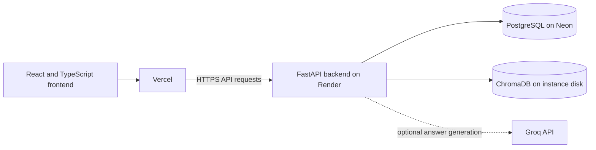

# Tutor LMS

A full-stack learning management system where tutors manage courses and coursework, and students enroll, submit work, and ask course questions.

## Live demo

- Frontend: [tutor-lms-ecru.vercel.app](https://tutor-lms-ecru.vercel.app)
- API docs: [tutor-lms-bt69.onrender.com/docs](https://tutor-lms-bt69.onrender.com/docs) (Swagger docs are enabled only when the backend runs with `ENVIRONMENT=development`.)

The backend runs on Render's free tier and sleeps when idle. The first request after inactivity can take about a minute while the service starts.

## Demo logins

| Account | Email | Password |
|---|---|---|
| Demo student | `demo-student@example.com` | 'Student@123' |
| Demo tutor | `demo-tutor@example.com` | `Tutor@123` |

These are shared demo accounts, and the data may be reset.

## Features

### Tutor

- Create courses and view the course catalog.
- Create assignments with due dates.
- Upload PDF course materials for indexing.
- View enrolled students and submissions.
- Grade submissions and provide feedback.

### Student

- Browse available courses and enroll.
- View enrolled courses and assignments.
- Submit work using a file URL and view grades and feedback.
- Ask course-related doubts and review recent answers.

## Doubt answering

1. The backend checks the course's answered-doubt cache. It converts cosine distance to similarity and reuses an answer when the score meets the configured threshold (default: `0.95`).
2. If there is no qualifying match, it retrieves relevant chunks from that course's indexed PDF materials.
3. If `GROQ_API_KEY` is configured, the backend sends the question and retrieved context to Groq. Otherwise it returns a local fallback based on the retrieved text.
4. The resulting answer is stored with the doubt and cached for later matching.

## Architecture



## Tech stack

| Area | Technologies |
|---|---|
| Frontend | React, TypeScript, Vite, React Router, Axios |
| Backend | Python 3.12, FastAPI, Pydantic, SQLAlchemy |
| Relational database | PostgreSQL, psycopg2 |
| PDF and retrieval | pypdf, ChromaDB, ONNX MiniLM embeddings |
| Authentication | JWT bearer tokens, bcrypt password hashing |
| Hosting | Vercel (frontend), Render (backend), Neon (PostgreSQL) |
| Optional answer generation | Groq API |

## Engineering notes

- The application database was migrated from SQLite to PostgreSQL for deployment.
- PyTorch and Sentence Transformers were replaced by Chroma's ONNX embedding function. In isolated PDF/doubt tests, measured peak backend memory was about **290 MiB** with ONNX, compared with about **510 MiB** in the earlier PyTorch/Sentence Transformers run.
- Doubt matching uses cosine similarity. The default threshold of `0.95` was selected conservatively after measuring paraphrase and related-but-different question scores; it may reject some valid paraphrases.
- Demo seeding is idempotent and can run in a background thread at startup when explicitly enabled. It rebuilds the demo PDF search index using deterministic vector IDs and upserts.
- `backend/scripts/seed_demo.py` runs the seed manually. `backend/scripts/cleanup_smoke_data.py` defaults to a read-only dry run; deletion requires `--apply`.

## Run locally

### Prerequisites

- Python 3.12.6
- Node.js and npm
- A PostgreSQL database

### Backend

From the repository root, create and activate a virtual environment, then install the runtime dependencies:

```powershell
cd backend
py -3.12 -m venv .venv
.\.venv\Scripts\Activate.ps1
pip install -r requirements.txt
Copy-Item .env.example .env
```

Edit `backend/.env` and set `DATABASE_URL` to your PostgreSQL connection URL and `JWT_SECRET_KEY` to a strong random value. Do not commit `.env`. Set `GROQ_API_KEY` only if you want Groq-generated answers.

Start the API from the `backend` directory:

```powershell
uvicorn app.main:app --host 127.0.0.1 --port 8000 --reload
```

The API is available at `http://localhost:8000`. In development, the docs are at `http://localhost:8000/docs`.

### Frontend

In another terminal:

```powershell
cd frontend
npm install
Copy-Item .env.example .env
npm run dev
```

The frontend runs at `http://localhost:5173`. Set `VITE_API_URL` in `frontend/.env` to the backend URL; locally, use `http://localhost:8000`.

### Tests

From `backend`, install development requirements and run pytest:

```powershell
pip install -r requirements-dev.txt
python -m pytest
```

Run tests with isolated local storage so they cannot use the database settings in `backend/.env`:

```powershell
$testRoot = Join-Path $env:TEMP ("tutor-lms-tests-" + [guid]::NewGuid())
New-Item -ItemType Directory -Force $testRoot | Out-Null
$env:DATABASE_URL = "sqlite:///$($testRoot.Replace('\', '/'))/test.db"
$env:CHROMA_PATH = Join-Path $testRoot "chroma"
$env:CHROMA_ONNX_CACHE_DIR = Join-Path $testRoot "onnx-cache"
$env:JWT_SECRET_KEY = "<LOCAL_TEST_SECRET>"
python -m pytest
```

## Environment variables

| Variable | Purpose | Required? |
|---|---|---|
| `DATABASE_URL` | SQLAlchemy database connection URL. | Yes |
| `JWT_SECRET_KEY` | Signs and verifies access tokens. | Yes |
| `DATABASE_URL_UNPOOLED` | Accepted by settings for an unpooled database URL; the current engine does not use it. | No |
| `JWT_ALGORITHM` | JWT signing algorithm; defaults to `HS256`. | No |
| `JWT_EXPIRATION_HOURS` | Access-token lifetime; defaults to `24`. | No |
| `ENVIRONMENT` | Runtime mode; defaults to `development`. API docs are enabled only in development. | No |
| `CORS_ORIGINS` | Comma-separated browser origins; defaults to the two localhost development origins. | No |
| `CHROMA_PATH` | Chroma persistent-data directory; defaults to `./chroma_data`. | No |
| `CHROMA_ONNX_CACHE_DIR` | ONNX embedding model cache directory. Set this for build-time prewarming on Render. | No |
| `DOUBT_SIMILARITY_THRESHOLD` | Minimum cosine similarity for reusing a cached answer; defaults to `0.95`. | No |
| `GROQ_API_KEY` | Enables Groq answer generation. Without it, the local context fallback is used. | No |
| `GROQ_MODEL` | Groq model name; defaults to `llama-3.1-8b-instant`. | No |
| `SEED_DEMO_ON_START` | Set to `true` to enable background demo seeding at startup. | No |
| `DEMO_TUTOR_PASSWORD` | Password for the seeded demo tutor; required when startup seeding is enabled. | Conditional |
| `DEMO_STUDENT_PASSWORD` | Password for the seeded demo student; required when startup seeding is enabled. | Conditional |
| `VITE_API_URL` | Frontend API base URL; defaults to `http://localhost:8000`. | No |

Keep credentials in environment configuration, not in source control. The Render platform supplies `PORT` for the backend start command.

## Deployment

### Render backend

- Root directory: `backend`
- Python version: set `PYTHON_VERSION` to `3.12.6` (also recorded in `backend/.python-version`).
- Build command:

  ```sh
  pip install -r requirements.txt && python scripts/prewarm_onnx.py
  ```

- Start command:

  ```sh
  uvicorn app.main:app --host 0.0.0.0 --port $PORT
  ```

- Set `CHROMA_ONNX_CACHE_DIR` to `.cache/chroma/onnx_models/all-MiniLM-L6-v2` so the build step prewarms the model cache inside the backend directory.
- Set `CORS_ORIGINS` to `https://tutor-lms-ecru.vercel.app`.
- Set `DATABASE_URL` and `JWT_SECRET_KEY`. Set `GROQ_API_KEY` if Groq responses are wanted.
- For demo deployments, set `SEED_DEMO_ON_START=true` and provide `DEMO_TUTOR_PASSWORD` and `DEMO_STUDENT_PASSWORD` through Render's environment settings. Do not put passwords in the repository.

### Vercel frontend

- Root directory: `frontend`
- Set `VITE_API_URL` to `https://tutor-lms-bt69.onrender.com`.
- `frontend/vercel.json` rewrites frontend routes to `index.html` for client-side routing.

## Known limitations

- Render's free-tier service sleeps when idle, so cold starts can be slow.
- Uploaded PDFs and Chroma data are stored on the backend instance disk and do not provide durable storage across restarts. The demo PDF index is rebuilt on startup only when demo seeding is enabled; uploaded materials are not automatically re-indexed.
- Tables are created with SQLAlchemy `Base.metadata.create_all`; the project does not currently use Alembic migrations.
- The backend test suite is small.
- Doubt matching is an embedding-based text-similarity heuristic, not a guarantee of equivalent meaning. The conservative threshold can miss paraphrases and cannot eliminate false matches.
- Student assignment submissions currently store a file URL; the backend does not upload those submission files.

## Roadmap

- Add Alembic database migrations.
- Expand backend and frontend test coverage.
- Add durable storage for uploaded files and vector data.
- Evaluate improved embedding models and doubt-matching approaches.

## Screenshots

Screenshots coming soon.
